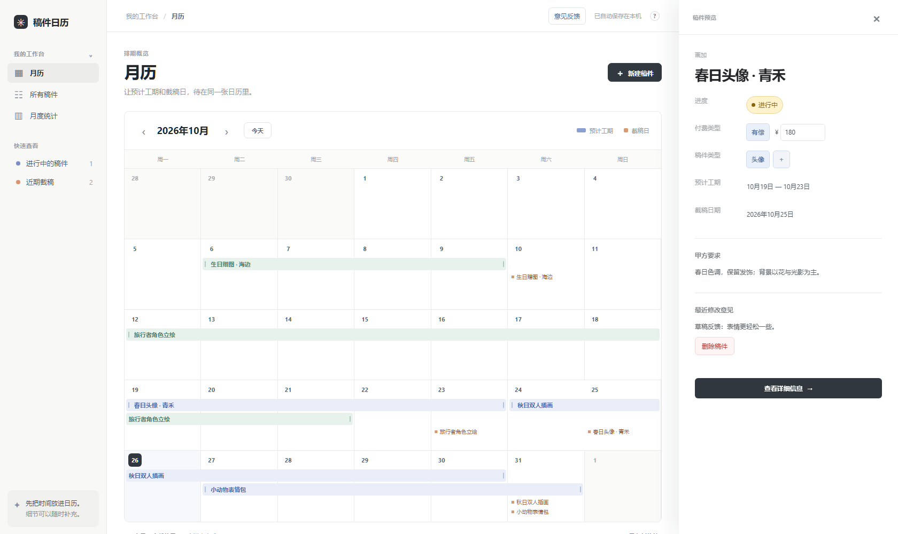
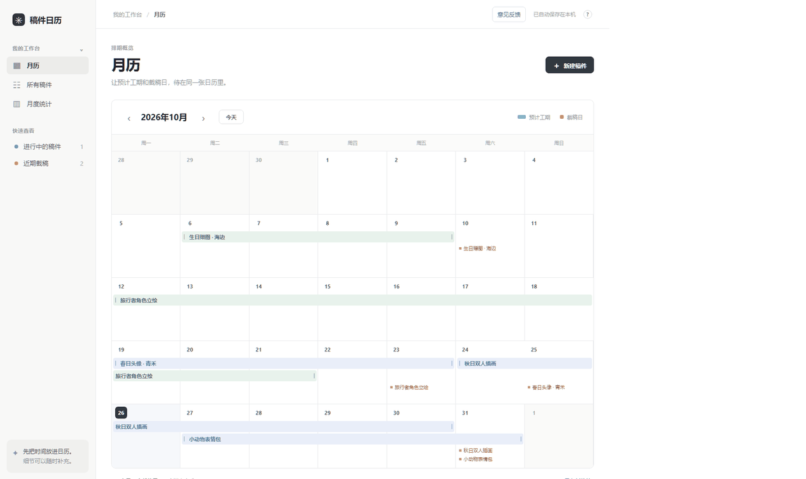

# 稿件日历

给画手以及其他类型接单选手用的接稿月历，把工期、截稿日和稿费放在一起。

不用安装，不用注册，打开就能安排稿件。

立即使用 · [意见反馈](https://ecnoym3y5vg8.feishu.cn/share/base/form/shrcnYEMNtQrZbq1O88VKujUkJg)



## 主要功能——月排单与回报✨

- **安排工期**：用跨天色带查看预计工期，拖动两端就能调整。
- **记录稿件**：要求、参考图、联系方式和修改意见放在一起。
- **回顾成果**：看看这个月完成了什么、赚了多少、工了多久。



## 第一次使用请看这里🙋‍♀️

1. 点击“新建稿件”，填写名称、预计工期和截稿日，保存。
2. 回到月历，点击稿件色带查看资料；拖动色带两端调整工期。
3. 交稿后，将进度改为“已完成”，核对实际完成日，再填写绘画耗时。

第一次打开有虚构示例，可以先试着操作，再清空示例录入自己的稿件。

## ❗❗你的稿件记录保存在哪里？（必读）

稿件和附件保存在当前浏览器里，不会被其他使用者看到。

请记住：

- 换浏览器、换设备，不会自动带过去。
- 清除网站数据，可能删除已有稿件。
- 不建议用无痕模式长期记录。
- 手机和电脑暂不支持自动同步。

**录入重要稿件后，请导出一份备份。**

在“所有稿件”中点击“导出备份”，将文件保存到你能找到的位置。
换设备时，在同一个网站中点击“导入备份”。

注意：导入会替换当前浏览器已有的稿件，请先备份。

## 放到移动端桌面请看这里📱

**安卓手机**

用 Chrome 打开网站，点击右上角“⋮”，找到“添加到主屏幕”。
其他浏览器的入口名称可能不同，请在菜单中查找“添加到桌面”。

**iPhone / iPad**

用 Safari 打开网站，点击分享按钮，选择“添加到主屏幕”。

桌面图标只是方便进入网站，不代表已经开启云端同步。

## 想在自己的电脑运行？💻

安装 Node.js，下载并解压本仓库，在文件夹中运行：

```bash
npm run dev
```

打开终端显示的网址即可，无需 npm install。

## 有想要的功能？告诉我👂

哪里不好用、遇到了什么问题，或者希望增加什么，都欢迎提出。

[填写意见反馈](https://ecnoym3y5vg8.feishu.cn/share/base/form/shrcnYEMNtQrZbq1O88VKujUkJg)

反馈时请遮住客户信息，不要上传真实订单备份。

[查看版本更新记录](docs/RELEASES.md)
